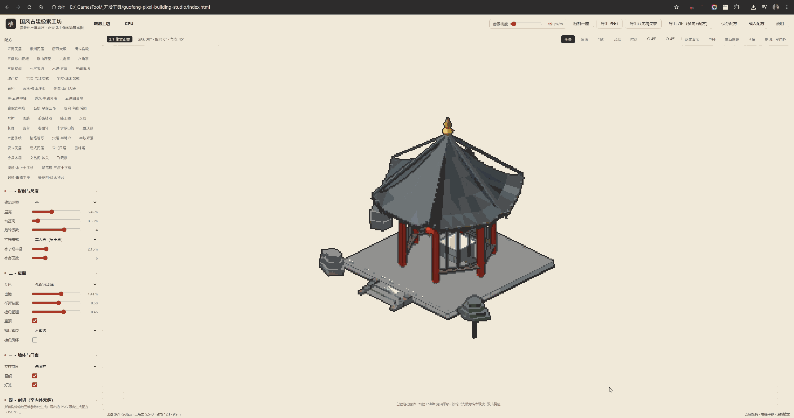
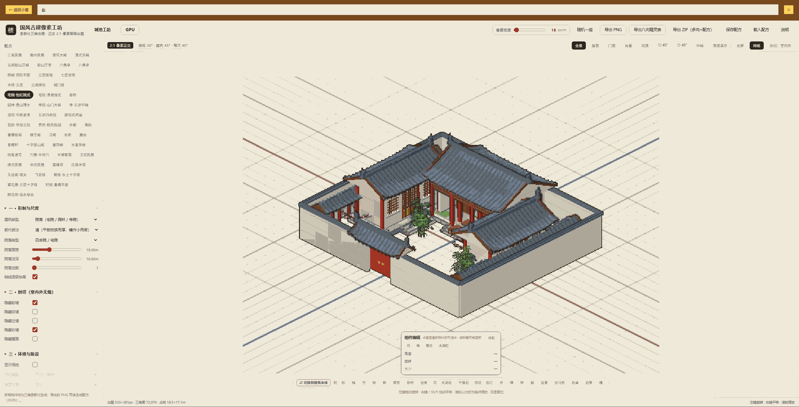

## 在线版：[小鸟咕噜噜工坊](https://www.xngullluu.top/?sc=3)




# 国风古建像素工坊 · Guofeng Pixel Building Studio

> 三维参数化古建构件 → 2:1 像素正交投影 → 像素化出图
> 纯前端、零依赖，双击 `index.html` 即可使用（file:// 直开）
> 持续更新中，欢迎反馈与贡献。

---

## 这是什么

参考 B 站 @迷有事 的“2D 像素风模块化”工具路线做的一套本地古建生成器：
建筑不是“画出来的”，而是用**三维坐标 + 参数化构件**搭出来，再用**正交相机投影成 2:1 等轴像素图**。
因此同一座建筑可以任意旋向、任意俯角、一键剖切（隐藏前墙/侧墙/屋面）看室内，室内外无缝衔接。

- 全部几何由代码生成，没有任何图片素材，出图即 PNG（可直接进游戏当素材）
- 每座建筑都能导出 1 向 / 4 向 / 8 向精灵表 + `recipe.json` 配方
- 中国风构件、陈设、造景元素数量是重点，可选项全部展开在左侧六组面板里

## 打开方式

1. 双击 `index.html`（推荐 Chrome / Edge）
2. 或双击 `启动工具.bat`
3. 命令行批量出图（需 Node 18+）：

```bat
node cli/render.js --preset yuanlin --out out/yuanlin.png
node cli/render.js --preset siheyuan --dirs 4 --out out/court_sheet.png
node cli/render.js --all --outdir out/presets
```

`--recipe 配方.json` 可加载自己保存的配方；`--ppm 24` 改像素密度，`--style ink` 强制手绘风格。

## 目录

```
guofeng-pixel-building-studio/
├─ index.html            界面
├─ css/app.css           宣纸墨色样式
├─ js/gf-core.js         向量 / 网格 / 调色板 / 配色
├─ js/gf-roof.js         屋面（庑殿·歇山·悬山·攒尖·卷棚·盝顶·十字歇山·腰檐）
├─ js/gf-parts.js        构件库（斗拱·台基·栏杆·门窗·楹联·藻井·陈设……）
├─ js/gf-build.js        各类建筑的装配器 + 院落造景
├─ js/gf-render.js       软件光栅化 + 阴影贴图 + 手绘风格化
├─ js/gf-presets.js      预设 / 随机 / 配方归一化
├─ js/gf-export.js       PNG / ZIP 编码
├─ js/app.js             界面逻辑
├─ cli/render.js         命令行渲染器
├─ docs/                 形制基准表 + 各阶段实测证据（md / json）
└─ out/                  出图目录
```

## 建筑类型（16 种）

殿/堂、民居、**院落**（四合院 / 江南园林 / 寺院 / 五进院 / 道观 / 廊院式 / 贾府）、亭、**水榭**、**画舫 ∕ 石舫**、**楼阁（带平座）**、塔、
牌坊、城门楼、**阙**、**长廊**、**露台**、廊桥、**圆殿（圆形平面：圆台基 + 环柱 + 圆墙 + 圆攒尖宝顶，可叠层）**、**城池**（城墙 / 城门 / 马面 / 角楼 / 里坊街格 / 中轴宫殿群 / 护城河）。

## 民居演变谱系（5 档）

穴居（半地穴、茅草穹顶、火塘草席）→ 半坡（木骨泥墙、两坡草顶、土阶）→ 汉式（夯土台、悬山直坡短檐、直棂窗、瓦当）→
唐式（庑殿、檐口平直起翘极小、鸱尾）→ 宋式（举折、歇山、格子门、一斗三升）；明清档由既有「江南民居」「徽州民居」承担。

## 塔与楼阁（8 座）

雷峰塔（八角五层、逐层平座、底层副阶）、应县木塔（八角、五层六檐、明五暗四）、文昌阁·城关（城台 + 券洞 + 台上二层 + 四角亭）、
飞云楼（三层四滴水、十字歇山、四面抱厦）、樊楼·水上十字楼、繁花居·三层十字楼、时楼·重檐平座、醉花阴·临水楼台。

## 城池（城制面板）

`city` 类型：城垣三段收分（石脚 → 砖身 → 压顶）+ 雉堞望孔（间距 / 宽 / 高均可调）+ 内侧女墙；城门（城台 + 券洞 + 城楼，门道 1 ∕ 3 ∕ 5）；
马面按「每面 N 座等距」（间距 ∕ 墙高落在 6~8 倍），可调面宽、突出量，台上敌楼可关；四角角楼；里坊网格（含街道铺装与中轴御道）；中轴宫殿群（门 → 台 → 三殿，台基递进）；
环濠闭合 + 驳岸贴墙基脚 + 城门石桥。新增：**瓮城**（屈曲开门、正面箭楼、跨濠台基）、**吊桥**（木桥面 / 栏杆 / 可收起），以及独立的垛口与女墙尺寸参数。
预置：城·唐长安（12×10＝108 坊）、城·洛阳（梯形、宫城偏西北隅）、城·明清北京（四面瓮城 + 箭楼 + 吊桥）、城·紫禁城。

**街巷与生活层**：主街铺条石，中间压一条御道石带；坊墙内侧留 L 形小巷，坊墙南面开坊门（门柱 + 横枋 + 门额 + 小瓦顶）；沿主街与坊门自动摆摊（案台 + 四腿 + 蓝白布棚 + 货）、幌子招牌与街灯，按「生活层密度」铺开，「夜市模式」灯更多。城制面板与城池页均有这组参数，紫禁城 / 宫城默认关闭。

## 屋面形制（7 种）

悬山/硬山、歇山、庑殿、攒尖（任意边数）、**卷棚（元宝脊）**、**十字歇山**、**盝顶**；
另有重檐、腰檐（楼阁平座处）、剪边（檐口换瓦色）、悬鱼惹草、檐角风铎、正脊/垂脊/鸱吻/脊兽/宝顶。

## 结构要点（逐层可调）

古建 wiki 里常被抽出来讲的那几件事，现在都在参数面板里能直接调，不用改配方文件：

| 结构点     | 面板位置                         | 说明                                                           |
| ------- | ---------------------------- | ------------------------------------------------------------ |
| 逐层层高    | 一 · 形制与尺度「逐层层高（殿 / 阁）」/「（塔）」 | 每层一个输入框，层数一变自动增减；拖动上面的「层高」滑块会清掉逐层值、回到统一层高                    |
| 逐层收分    | 一 · 形制与尺度「逐层收分比」             | 只对塔生效，第 i 层的半径按前 i 个比值连乘，默认 0.89（≈传统线性收分）                    |
| 层间平座    | 一 · 形制与尺度「层间平座（木围栏）」         | 塔/楼阁式每层檐上加一圈挑台（整片铺板，不是只画一圈边），可关；开着时上层塔身直接坐在平台上，不留断缝          |
| 檐口对位    | 二 · 屋面「檐角起翘」                 | 起翘只抬角，边中檐口正好落在柱头/檩条上；廊桥、亭、敞轩、抄手游廊的顶都按这条压柱                    |
| 平座栏杆    | 一 · 形制与尺度「平座栏杆」              | 木栏杆 / 石栏两种，地栿 + 坐凳楣子 + 寻杖三段都补齐，底部不再透空                        |
| 腰檐 / 重檐 | 二 · 屋面「重檐层数」                 | 多层楼的层间薄檐，坡高只留 0.46m                                          |
| 斗拱铺作    | 三 · 墙体与门窗「斗拱 / 铺作 / 栱眼壁」     | 一斗三升、五踩、七踩，按层高自动缩                                            |
| 举折 / 起翘 | 二 · 屋面「举折坡度 / 檐角起翘」          | 逐类型生效，塔檐随收分同步减薄                                              |
| 副阶周匝    | 一 · 形制与尺度「副阶周匝（底层围廊）」+「副阶出挑」 | 塔：底层一圈柱加腰檐；殿 / 厅堂：四周一圈廊柱 + 一层下檐，出来就是重檐。出挑 0.8–3.0m 可调，台基自动放大 |
| 逐层出檐    | 一 · 形制与尺度「逐层出檐」              | 塔每层一个数值（0.3–2.0m），与收分一起乘，形成下大上小的轮廓                           |
| 逐层斗拱铺作  | 一 · 形制与尺度「逐层斗拱铺作」            | 塔每层 0–3 档（0 无 / 1 一斗三升 / 2 五踩 / 3 七踩），斗拱贴在檐口下沿一圈，出跳随档数加深     |

术语对照（wiki 词条）：平座、腰檐、收分、举折、起翘、斗拱铺作、副阶周匝。
副阶周匝两处都已实现：塔是底层八面围廊（柱础落台明、外檐压柱头、内檐贴塔身），殿 / 厅堂是四周廊柱加深一层下檐（主屋顶仍在上，形成重檐）。

## 构件与细部（可勾选）

- 台基：须弥座（含束腰莲瓣）/ 直台基（阶条石）/ 毛石台；踏跺含垂带石
- 栏杆：石栏望柱 / 木寻杖栏杆 / 美人靠（吴王靠）
- 斗拱：一斗三升 / 五踩 / 七踩重拱，可加栱眼壁
- 门窗：隔扇门、板门（门钉门环）、格心步步锦/直棂/冰裂纹/灯笼框/万字/海棠/六角龟背
- 门饰：匾额、楹联、门簪、抱鼓石
- 天花：井口天花 / 藻井（三层方井 + 明镜 + 垂莲）
- 院墙：压顶小脊、月洞门（券石）、漏窗花格

## 陈设与造景

石狮、香炉、灯笼、幡、石灯、井（含辘轳架）、碑、钟、鼓、盆景、拴马桩、太湖石假山、
水池 / 花池、曲桥、竹 / 松 / 梅 / 柳 / 银杏 / 阔叶 / 芭蕉 / 红枫、石桌石凳、屏风书架榻香案佛龛。

三类院落的造景逻辑（参考“叠山理水、框景漏景、对景添景”的中式手法）：

- **四合院 / 宅院**：垂花门 → 正房（带前廊、碧纱橱）→ 东西厢房 → 抄手游廊 → 院内竹木花池
- **江南园林**：月洞门 + 影壁对景 → 水池居中 → 环池叠石 + 主峰太湖石 → 曲桥 + 湖心亭 → 临水敞轩 → 游廊竹木
- **寺院**：山门（一门三洞、前后贯通、内外踏跺）→ 钟楼/鼓楼（檐檩 + 角梁压柱、檐口落在檩面）→ 五间大殿（庑殿、斗拱、石栏、殿内佛龛组居中）→ 香炉、石狮、幡、功德碑（立于前院，不入殿）
- **寺·五进中轴**：山门 → 钟鼓楼 → 天王殿 → 大雄宝殿（三层台基 + 月台）→ 法堂 → 藏经阁；东西配殿与东西院在中轴之外，台基逐进抬高
- **道观**：山门 → 灵官殿 → 三清殿（月台）→ 三清阁，中路更短更紧
- **五进四合院**：倒座 → 垂花门 → 二进（厢房 + 正房）→ 三进（正房 + 耳房）→ 四进 → 后罩房；抄手游廊通长连接
- **廊院式祠庙**：主殿居中，四周回廊庑围合成院，转角处两段廊中心线交于角柱
- **贾府**：前府（大门 → 仪门 → 正厅 → 内宅 → 后罩楼 + 东西跨院）+ 后园（叠山理水、亭榭舫）
- **石舫 ∕ 旱船**：前舱（歇山敞亭）→ 中舱（两坡船篷）→ 尾舱（二层楼阁），三段层高不同，船头平桥接岸

## 绘画风格（8 种）

渲染默认走 WebGL2 硬件光栅（GPU），失败自动回落软件光栅化：z-buffer 逐三角形，按法线与光向取三级色阶；地面按世界坐标采样阴影贴图；
描边分“外轮廓墨线”和“内部材质/深度突变压暗”两套。

右侧「六 · 绘画风格」单独成组，三个控件互不耦合：**画风**决定后处理算法，**风格强度**决定该画风的力度，**配色底子**决定用哪套色。

| 画风       | 特征                               | 适合         |
| -------- | -------------------------------- | ---------- |
| 像素硬边（原味） | 纯墨勾线、转折压暗，线条最干净                  | 直接进游戏的等轴素材 |
| 水墨手绘     | 纸纹颗粒、墨色浓淡、蚀刻排线、断笔抖线，去彩留朱         | 立绘、卷轴风插画   |
| 枯笔速写     | 更重颗粒与赭墨偏色，线条断续，像速写本              | 草图、构想稿     |
| 双色套印     | 红蓝通道 1px 错位，模拟套色版画轻微走版           | 年画、招贴      |
| 工笔重彩     | 颗粒≈1.5、饱和度抬高、受光面加亮，勾线 0.66 细线不断笔 | 建筑细部展示     |
| 木刻版画     | 明度压 4 阶保留色相，暗面斜排刀纹，边缘粗黑线外扩一格     | 版画、封面      |
| 金石拓片     | 明度转“纸—墨”单色，随机缺墨斑驳，勾线用墨           | 碑刻、图谱      |
| 水彩晕染     | 5×5 加权洇开、去饱和、掺纸色、低频道斑、淡勾线        | 概念图、氛围图    |

配色底子「水墨·宣纸」「赭石·双套印」「青绿·绢本」三套，与任一画风都能自由组合。

## 渲染内核（GPU / CPU）

顶栏「GPU / CPU」是渲染内核开关，预览和导出共用同一个开关，不再是“预览用 GPU、导出永远 CPU”。

- **GPU**：WebGL2 硬件光栅，投影、z-buffer、色阶、砖缝木纹、地面阴影在显卡上跑（描边仍在 CPU 上勾）。同尺寸实测 1798×1437：GPU 98ms、CPU 322ms；逐像素平均色差 0.48/255（面级颗粒系数用同一套面中心哈希）。
- **回落条件**：浏览器没有 WebGL2、Framebuffer 建不起来、出图尺寸超过 `MAX_TEXTURE_SIZE`、GL 报错，任一命中就返回 `null` 交回 CPU；交互时连续两帧回落会把开关自动切到 CPU 并在状态栏写明原因。
- **导出**：单张 PNG、八方向精灵表、ZIP 都按当前开关出图，状态栏显示 `全精度出图 W×Hpx · GPU/CPU Nms`。选 CPU 时与旧版逐字节一致，便于回归比对。
- 显卡名与纹理上限可在调试台用 `GF.gpuInfo()` 取（`renderer` / `vendor` / `maxTexture` / `maxViewport`）；失败次数累计在 `GF.__gpuFail`。

## 视口地面栅格

顶栏「网格」是视口辅助显示，默认开着，状态记在 `localStorage.gf.grid`。样式照 3ds Max / Blender 的初始平面栅格：格线落在 y=0 地面上，默认 1 m 一格、每五格加重一道，X 轴偏红、Z 轴偏蓝，离画面中心越远越淡。

- 档距随缩放自动升档（1 / 2 / 5 / 10 / 25 / 50 / 100 m），任何倍率下格距都不小于 10 px，缩得很小时不会糊成一片。
- 遮挡：CPU 出图会多回一份「被物件压住的像素」遮罩（`GF.render` 的 `gridMask`），格线画在画面上层、按遮罩抠洞，所以格线铺在地面铺装上、被墙体和屋顶自然遮住，跟有地面的 3D 视图一致；GPU 出图不带遮罩，此时栅格垫在画面底下，靠不透明像素自己盖住。
- 只是视口辅助：单张 PNG、八向精灵表、ZIP 导出都不画栅格。

## 配方与扩展

- 「保存配方 / 载入配方」导出/导入 JSON，全部参数都在里面
- 「导出 ZIP」＝ 4 向 PNG + 拼版 + `recipe.json`
- 加新构件：在 `js/gf-parts.js` 写函数 → 挂到 `GF.parts`；加新屋面：`js/gf-roof.js` 里写 builder → 在 `GF.roofs` 里派发
- 加新建筑类型：`js/gf-build.js` 写 `buildXxx()` → `GF.build` 的 switch 里加 case → `js/app.js` 的 `TYPES` 加一项
- 控件有效性自检：`node cli/audit.js`，逐类型逐参数换值比对网格签名，列出“换了值也不变”的项，用来排查新增控件是否真的接上了

## 参考与素材来源

- 工具路线（B 站）：@迷有事《2D 像素建筑模块化》BV1KBWq6LEim / 室内外无缝 BV1bcsP6xE5T；@东君之桃 红楼梦院落复原（怡红院 BV1t3by6yEqN、潇湘馆 BV1c8ag6LEpP）
- 造景手法（B 站）：框景漏景 BV19u556YEcJ、对景添景 BV16C5E6dEmm
- 手绘风格库：https://github.com/yang0/handraw-style
- 古建开源参照（构件比例、形制与细部对照）：
  - https://github.com/xyiqq/china-heritage-3d
  - https://sketchfab.com/tags/chinese-architecture
  - https://sketchfab.com/tigerofchen/collections/chinese-traditional-architecture-158e6234ff5b4a8ab4930d0956fb4493
  - https://www.cyark.org/
  - https://github.com/in-a-mist/miniLibs
  - https://ip.e-dunhuang.com/
  - https://caalib.cn/
  - 中国古建 wiki：https://github.com/Chartreuse310/chinese-architecture-wiki-online
- 落成演示思路：https://github.com/lhlGitHub/threejs-architecture-effects （单条 0–1 时间线驱动“基础→柱梁→墙面→屋面→脊饰”依次装配，支持暂停/重播）

## 结构参考（B 站形制拆解）

做各类型的开间、柱网、檐口与台基比例时，按下列拆解视频对照（链接为原始 BV 号，“工具内对应”写目前落到哪个预置/形制，标“待补”的还没做）：

| 类型        | 参考                                                                                                                                                                                                                | 工具内对应                                                |
| --------- | ----------------------------------------------------------------------------------------------------------------------------------------------------------------------------------------------------------------- | ---------------------------------------------------- |
| 塔         | 应县木塔结构原理动画 [BV1MqHi6gEH9](https://www.bilibili.com/video/BV1MqHi6gEH9/) · 木塔构件 [BV1mJQnY3EbV](https://www.bilibili.com/video/BV1mJQnY3EbV/) · 木塔结构拆解 [BV1qY4y1w78x](https://www.bilibili.com/video/BV1qY4y1w78x/) | 预置「应县木塔」（八角、五层六檐、逐层平座、副阶周匝）与「雷峰塔」「七层宝塔」「木塔·五层」       |
| 塔（楼阁式）    | 雷峰塔 [BV1tA41117QX](https://www.bilibili.com/video/BV1tA41117QX/)                                                                                                                                                  | 「雷峰塔」：五层八角、塔身对径 ∕ 通高 ≈ 0.39（对表锚点 0.39）               |
| 另一种塔（楼阁式） | 雁栖塔 [BV1Nv9BBHE61](https://www.bilibili.com/video/BV1Nv9BBHE61/)                                                                                                                                                  | 「七层宝塔」，收分与檐口厚度按此调                                    |
| 六角亭       | 六角亭 3D 模型 [BV1tZ4y157v5](https://www.bilibili.com/video/BV1tZ4y157v5/)                                                                                                                                            | 预置「六角亭」                                              |
| 八角亭       | 八角亭 3D 模型 [BV1RZ4y1K7oF](https://www.bilibili.com/video/BV1RZ4y1K7oF)                                                                                                                                             | 预置「八角亭」（本次新增）                                        |
| 佛殿        | 大佛殿 [BV1V8411w7MJ](https://www.bilibili.com/video/BV1V8411w7MJ)                                                                                                                                                   | 「寺·五进中轴」（大雄宝殿三层台基 + 月台 + 殿内佛龛组）；单进寺院见「寺院·山门大殿」       |
| 县衙        | 古代县衙 [BV16HkkB4EuX](https://www.bilibili.com/video/BV16HkkB4EuX)                                                                                                                                                  | 近似「宅院·怡红院式」，仪门/大堂序列待补                                |
| 四方大殿      | 汉代四方形大殿（未央宫前殿）[BV1xU14BeEFX](https://www.bilibili.com/video/BV1xU14BeEFX)                                                                                                                                         | 「汉式民居」（低台基 + 悬山直坡短檐 + 直棂窗 + 瓦当）                      |
| 道观        | 道观小院 [BV1ka4y1L7f9](https://www.bilibili.com/video/BV1ka4y1L7f9) · 道观 [BV1sHLnzXErM](https://www.bilibili.com/video/BV1sHLnzXErM)                                                                                 | 预置「道观」（山门 → 灵官殿 → 三清殿 → 三清阁）                         |
| 钟鼓楼       | 唐式钟鼓楼 [BV1sy4y1B78B](https://www.bilibili.com/video/BV1sy4y1B78B)                                                                                                                                                 | 寺院 ∕ 寺五进 ∕ 道观三处双楼对峙；檐檩 + 角梁压柱，檐口－柱头间隙 0              |
| 五间歇山正殿    | 五间歇山正殿 [BV1ra411w7SL](https://www.bilibili.com/video/BV1ra411w7SL)                                                                                                                                                | 预置「五间歇山正殿」（本次新增）                                     |
| 三进四合院     | 三进四合院 [BV1p44y1Q73Q](https://www.bilibili.com/video/BV1p44y1Q73Q/)                                                                                                                                                | 预置「五进四合院」（倒座 → 垂花门 → 二进 → 三进 → 四进 → 后罩房，进深 ∕ 面宽 2.0） |
| 楼阁        | 唐风楼阁 [BV1GLhd6bEDm](https://www.bilibili.com/video/BV1GLhd6bEDm/)                                                                                                                                                 | 「飞云楼」（三层四滴水 + 四面抱厦）、「时楼·重檐平座」「文昌阁·城关」「三层楼阁」「重檐楼阁」    |
| 滕王阁       | 滕王阁 [BV1StGYzxEcK](https://www.bilibili.com/video/BV1StGYzxEcK/)                                                                                                                                                  | 预置「滕王阁」（本次新增）                                        |
| 开元寺三种楼阁   | 开元寺楼阁样式 [BV15WJy6PEry](https://www.bilibili.com/video/BV15WJy6PEry/)                                                                                                                                              | 「重檐楼阁」可近似，三种样式变体待补                                   |

## 场地（平地 / 湖面 / 湖畔 / 两岸）

「显示场地」打开后可选的场地类型，不再固定一块方地台：

| 类型     | 效果                                   |
| ------ | ------------------------------------ |
| 平地     | 按石板 / 砖 / 夯土 / 草地 / 汉白玉铺满整块场地，可选门前甬道 |
| 整片湖面   | 整块水面铺到场地边缘，适合水榭、画舫、临水殿               |
| 湖畔（单岸） | 建筑脚下留岸地，岸线外侧全是水面，岸线压一道驳岸条石           |
| 两岸（水道） | 近岸 + 中间水道 + 对岸，两侧各一道驳岸，适合廊桥、渡口、水口    |

水面在前 / 后 / 左 / 右可调，水面宽度与场地半径也都在面板里；水面带波光水纹，岸线有驳岸压顶。

## 光照与阴影

渲染面板新增「光照方位」（东 / 东南 / 南 / 西南 / 西 / 西北 / 北 / 东北）与「阴影长度」：
方位角通过绕 Y 轴旋转光向量实现，同时改变受光面明暗与投影方向；阴影长度用压低太阳高度模拟长影 / 短影。

## 组件拖拽条（环境与陈设的取用面板）


画布底边、键位提示栏正上方是一条组件拖拽条，按「树 / 石 / 陈设」三组列出二十种可放置物件：

- **拖进地图**：从条上按住任一组件卡拖到画布任意位置，松手即在该点落地（按视图反投影求世界坐标，缩放与俯仰都跟手）；不方便拖的时候点一下卡片，也会落在画面中心；
- **逐件调整**：点地图里的物件即选中，画布上给白底金框名称牌 + 金色虚线圆 + 四角对焦框 + 地面十字落点；下方编辑面板常开，列出已放各件，三根滑条——高度（−1 m ~ +3 m）、旋转（0° ~ 360°）、大小（0.5 ~ 1.6 倍）——拖动即时重绘，未选中时滑条置灰；
- **配方件也一样**：预设自带的树、假山、幡、石灯 / 井 / 碑 / 钟 / 鼓 / 盆景 / 拴马桩，首次构建时按 `trees / rocks / banners / props` 展开成单件（存在 `env.auto`），与手动拖入的件一起列在面板里；虚线卡是配方自带件，标「· 新」的是后来加的，两类都能选中、移位、调高度 / 旋转 / 大小、删除；
- **数量自由**：同一种组件可反复拖入，各件独立记在配方的 `env.items` 里（`k / x / z / y / rot / s`），预设件记在 `env.auto`，保存、载入、导出配方都会带上；
- **选中即改**：所有改动直接写回配方，删除按面板上的「删除」，取消选中按「取消选中」，面板可用「收起」临时藏起。

这样一来配方里的环境陈设也不再是「写死的背景」，而是和手动放置的组件一样逐件可调；「环境里放几棵树、几块石」也不必再为每种数量单开菜单项。

## 建筑本体栏（台基 / 逐层 / 屋面分开调）

画布底边同一个位置还有第二套选择栏与编辑器，装的是建筑本体。原来散在左侧「形制与尺度 / 屋面 / 墙体与门窗」里的逐件参数已全部并进这套编辑器，左侧菜单只留类型、尺度、场地、剖切、画风、城制与出图这些整体项：

- **一个按钮换两种类型**：栏首的「⇄ 切换到建筑本体 / ⇄ 切换到陈设组件」在两套栏之间来回，同一时刻只有一套栏在场；切换时两套编辑器同步换手——建筑模式下环境编辑器收起，陈设模式下建筑编辑器收起，选中的物件 / 楼层也一并清空，不会有两块面板叠在一起；建筑模式下画布也不再拾取树、石、陈设（`pickItem` 与陈设拖动都在这一模式下关闭，改成拾取建筑），点画面不会突然选中一棵树；
- **建筑按段拆开**：栏里是「台基 / 第 1 层 / 第 2 层 / 第 3 层 / 屋面 · 脊饰」，楼阁、多层殿按 `floors` 逐层列出，塔按 `tiers` 逐层列出（单层建筑写作「屋身」）；点栏上或编辑器里的段位即选中那一段，画布上给金色虚线包围盒 + 名称牌，屋面框按举折算出脊高、贴着屋脊收；
- **每段自己的参数**（与左侧原控件同源，改动都写回配方并即时重建）：
  - 台基：台基高、踏跺级数、台基形制（须弥座 / 直台基 / 毛石台）、栏杆开关、栏杆样式、门前甬道；
  - 每层 / 屋身：层高、出檐、收分（塔与阁）、斗拱开关、铺作样式、逐层铺作档、栱眼壁、雀替、墙面材质、立柱材质、格心样式、窗宽、窗高、门式、门宽、门高、匾额、楹联、门簪、抱鼓石、天花藻井、层间平座与平座栏杆、副阶周匝与出挑、灯笼、石狮、香炉、马头墙、抱厦、城关城台、彩楼欢门；
  - 屋面 · 脊饰：屋顶形制（悬山 / 歇山 / 庑殿 / 攒尖 / 卷棚 / 十字歇山 / 盝顶）、瓦色（青瓦 / 陶瓦 / 黄琉璃 / 绿琉璃 / 孔雀蓝）、出檐、举折、起翘、重檐层数、正脊、脊兽数、宝顶、檐口剪边、悬鱼惹草、檐角风铎；
- **瓦色要连材质一起换**：绿琉璃在配方里写作 `celadon`，编辑器改瓦色时同时把 `tile / tileB` 换成 `glazeG / glazeGD`（黄琉璃、孔雀蓝、陶瓦同理），否则只改色名不换瓦材，画面不会变；
- **首层层高兼写 `floorH`**：亭、门、台、桥这类不走逐层数组的单体，屋身滑条同时把 `floorH` 改掉，拉到 5 m 屋身就真的长到 5 m；
- **编辑器可拖动、滑条能连续拖**：两个面板都挂同一套 `makeDraggable`，抓标题条即可移动，面板默认收在画面右侧不挡模型；滑条拖动期间只更新配方与轻量重建（80 ms 合并一次），不再整块重画面板 HTML，所以能一路拖到底而不是动一格就断。
  
  

## 拖动陈设

不需要开关，陈设模式下鼠标左键按住树、假山、石灯、井、碑、钟、鼓、盆景、拴马桩、幡旗、水池即可拖动；建筑模式下按住某一栋（或单栋建筑的建筑本体）同样能拖动，松手落位：

1. 点击物体附近即可选中（按正交投影反算世界坐标，不依赖像素颜色）；
2. 拖动时按地面平面移动，松手即落位；
3. 结果写进配方的 `env.move`（如 `{"tree0": {"x": -9, "z": 8}}`），保存 / 载入配方后保持原位。

## 落成演示

顶栏「落成演示」按钮播放约 2.8s 的自装配动画：按标高把构件从下往上逐层显现（`GF.render` 的 `clipY` 参数只画进度线以下的三角面；开 GPU 后由片元着色器的 `u_clipY` 做同样的裁剪，两条渲染路径进度一致），播放时降到 13 ppm 保证帧率，播完自动回到设定精度重绘；再点一次即停止。思路参考 <https://github.com/lhlGitHub/threejs-architecture-effects>（单条 0–1 时间线驱动“基础→柱梁→墙面→屋面→脊饰”依次装配）。

## 细部精细化（依古建 wiki / caalib / 数字敦煌对照）

- 檐口「瓦当—滴水」相间节奏：`js/gf-roof.js` 的 `addEaveTiles` 每段檐口同时生成瓦当（圆头）与滴水（下垂舌瓦）
- 檐口「连檐」：瓦当带下方通长一条木色连檐，明确檐口与瓦面的分界
- 窗「窗楣 + 窗台」：`js/gf-parts.js` 的 `windowAt` 上部挑出窗楣与窗楣线、下部压一道窗台，宽出窗洞，立面不再只有一块窗板
- 台基「御路石」：三级以上踏跺居中铺一条斜置云纹御路石（`platform` 内 `st >= 3` 分支）
- 墙脚「阶条石 / 腰线」：首层墙脚压一道条石（勒脚），二层以上改做横向腰线，避免墙体直接插进台基
- 塔身「贴面开窗」：塔窗改为贴在八角塔身侧面上的面片（木框 + 深色窗心），不再用方块戳出塔身轮廓
- 城台「三段收分」：石脚 → 砖身（带横向砖缝皮条线）→ 压顶条石；垛口加望孔
- 城门「券脸 + 门框」：沿拱圈排一圈券脸石与券脚，门扇加抱框、上槛、门缝、铺首、门槛；门钉改成按门扇实际宽度排布的小钉，转视角不再糊成栅格
- 柱础、额枋彩画、斗拱铺作、匾额楹联、门簪抱鼓石、悬鱼惹草、脊兽与宝顶均已按形制参数化生成
- 檐下木作：沿屋面自身参数面在檐口与内圈各取一点定方向，排檐椽（圆椽、椽头缩进、椽尾出挑）与飞椽（方料、出头、朱红椽头）；檩、檐椽、飞椽、瓦口四层叠出，斗栱不再埋在檐口里
- 朝代做法「七档」：`GF.ERA`（汉 / 唐 / 宋 / 金 / 元 / 明 / 清）按朝代定阑额断面、普拍枋有无与厚薄、铺作疏密与材色；殿身、厅堂、楼阁腰檐、城楼同随朝代切换
- 植物「真结构」：松为主干四段渐细 + 六轮轮生枝（下四上三）+ 三级分杈 + 枝端与侧芽的三维针球（每球九至十二根针，方位仰角各异）；竹为丛生六到七竿、一竿七节逐节收细、节处凸环、每节互生一到二枝、每枝三小枝、小枝端五到七片窄长叶、竿顶另有一簇；柳为主干短粗 + 六到八粗枝、枝端各垂七到九条柳条且条上互生小叶；梅为老干弯势 + 四五主枝 + 三级小枝 + 沿枝散布的五瓣花与花蕾；枫、银杏、杂树同为「主枝分杈 + 枝端叶簇」，芭蕉八片长扇叶外垂
- 假山「真孔洞」：太湖石为一对粗腿到腰、石冠三层跨过两腿的石拱，中间那孔前后左右都贯通；石面按三重正弦起伏做溶蚀皱，冠顶压错位横石与短峰。千层石按沉积岩层理：层厚分明、层面带波痕、整体缓倾、出挑极小、层间夹薄泥层，宽而矮、顶上平压一层

## 朝代做法（七档形制）

「朝代做法」是「一 · 形制与尺度」里的一档下拉，只改檐下木作的形制与断面，不动开间、柱网与屋顶类型。断面尺寸一律按阑额厚 `lanT` 取倍数，铺作大小另给缩放 `dgK`。

| 朝代  | 普拍枋（相对阑额厚）                 | 阑额                     | 铺作                | 材色与彩画      |
| --- | -------------------------- | ---------------------- | ----------------- | ---------- |
| 汉   | 无                          | 高 0.30、厚 0.13          | 仅柱头，缩放 0.90       | 丹粉（朱）      |
| 唐   | 无（斗栱直接坐阑额，佛光寺式）            | 高 0.36、厚 0.14          | 柱头 + 一朵补间，缩放 1.10 | 丹粉（朱），阑额素枋 |
| 宋   | 宽 1.60、高 0.45（扁宽，与阑额成 T 字） | 高 0.34、厚 0.13          | 柱头 + 一朵补间，缩放 0.92 | 丹粉（朱），阑额素枋 |
| 金   | 宽 1.10、高 0.62（渐厚）          | 高 0.32、厚 0.13          | 柱头 + 一朵补间，缩放 0.85 | 丹粉（朱），阑额素枋 |
| 元   | 宽 0.95、高 0.62              | 高 0.30、厚 0.14，端部收分成月梁形 | 柱头 + 一朵补间，缩放 0.80 | 青绿彩画       |
| 明   | 宽 0.80、高 0.60（狭于阑额）        | 高 0.30、厚 0.15          | 铺作小而密，缩放 0.72     | 青绿彩画       |
| 清   | 宽 0.75、高 0.58（清式平板枋宽三斗口）   | 高 0.28、厚 0.16          | 铺作小而密，缩放 0.68     | 青绿彩画 + 枋金线 |

栱眼壁按三段做：阑额以上为深色垫板，其上是素壁（唐宋灰白、明清青绿），最上为通长柱头枋。柱头枋与垫板沿整间连续生成，不按每朵斗栱各画一块，铺作稀疏的唐宋档也不会在朵间露缝。

条文的出处：梁思成《中国建筑史》宋辽金实物一章（普拍枋唐初已见、北宋末尚有省而不用者如初祖庵；早者扁而宽与阑额成 T 字如薄伽教藏，后渐加厚如善化寺三圣殿与山门，至明清竟狭于阑额；玄奘塔下三层以普拍枋承斗栱、最上两层斗栱直接安于柱头；元阳和楼阑额刻作假月梁形、普拍枋出头刻瓣）与《图像中国建筑史》手绘图的阑额普拍枋断面演变图，材分取宋《营造法式》材广十五分、厚十分、栔六分（转引自上书）。

## 形制依据（参考书目）

构件的比例、层次与做法以下列资料为准。梁思成两书为形制主依据，其余用于分件定比例、定纹理。

| 资料                                                | 取用的部分                                                                                                    | 对应实现                                                                                |
| ------------------------------------------------- | -------------------------------------------------------------------------------------------------------- | ----------------------------------------------------------------------------------- |
| 梁思成《中国建筑史》                                        | 台基—屋身—屋顶三段比例、大式／小式的斗栱有无、举折与收分；阑额与普拍枋的历代演变、玄奘塔的施用自由、元阳和楼的月梁与出头                                            | 各 `build*` 形的比例基准；`GF.ERA` 七档断面与 `pingban()` 普拍枋                                    |
| 梁思成《图像中国建筑史》手绘图                                   | 历代斗栱演变（唐 857 佛光寺至清 1776 文渊阁，十三例）、阑额与普拍枋演变、耍头（梁头）演变、殿堂外观演变；敦煌唐代详图构件名（鸱尾、垂脊、角脊、博脊、平坐、勾栏、望柱、斗子、蜀柱、盆唇、华版、地栿） | `dougong()` 逐跳华栱 + 栱头卷杀 + 散斗 + 昂，二档拱眼壁与柱头枋、三档枋金线；`addRidge()` 三线脚脊身与鸱吻；宋后阑额上加普拍枋的层次 |
| 维基百科「中国建筑」                                        | 须弥座六层（圭脚、下枋、下枭、束腰、上枭、上枋）、柱础、屋顶各部名称                                                                       | `platform()` 须弥座棱台串 + 玛瑙柱 + 角柱；`railing()` 望柱、华板、寻杖、宝瓶                              |
| 中国文化研究院「中国建筑」                                     | 台基—屋身—屋顶三段论、大式有斗栱、小式无斗栱、离方遁圆                                                                             | 台基收分与檐口出挑的取值                                                                        |
| 香港教育局《园林植物》                                       | 松、竹、柳、莲、兰的形态特征与配置地位                                                                                      | 松的轮生枝与三维针球、竹的七节竿与互生枝、柳的垂条与互生小叶、梅的疏枝着花、枫银杏的枝端叶簇                                      |
| 香港土木工程拓展署《HK Geology: A 400-million-year journey》 | 三大岩类、层理、柱状节理、花岗岩晶粒 1–3 mm、砂岩粒径 0.06–2 mm                                                                 | 石材颗粒粒径与层理方向（毛石台、条石、锦纹石）；千层石按层厚分明、层面波痕、整体缓倾、层间夹泥层                                    |
| 百度百科「石头」                                          | 四大名石、瘦皱漏透丑、千层石条带、卵石磨圆                                                                                    | 太湖石的溶蚀皱面与贯通石孔（一对粗腿撑一叠石冠的拱洞），冠顶错位横石与短峰                                               |
| 陈从周园林观（《设计》2024 年第 9 期）                           | 因地制宜、小中见大、虚实相生、借景对景；园路、花坛、水池、假山的细部                                                                       | 院落叠山理水、影壁对景、池岸与曲桥                                                                   |
